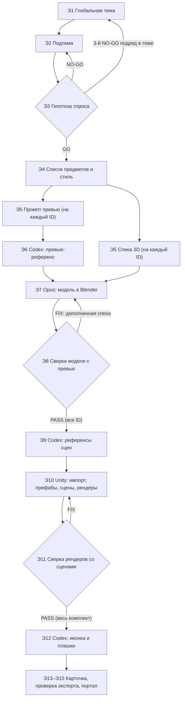

# Агентный конвейер производства пака

Версия: 0.5 (черновик плана) · Дата: 2026-11-24 · Статус: план; пусковая часть написана, конвейер ещё не запускался. 0.2: критерии спроса Э3, генератор Codex, исполнитель Э13–Э15. 0.3: возврат NO-GO на Э2 с переходом на Э1 после трёх отказов; Opus строит модели в живом Blender через MCP. 0.4: работа порциями и лимиты (раздел 5). 0.5: skill оркестратора, брифы ролей, шаблоны (раздел 8).

Документ описывает, **кто** (агент или человек) выполняет каждый этап производства пака, **в каком порядке**, что передаётся между этапами и куда работа возвращается при отказе. Содержание этапов и критерии качества берутся из [PLAN.md](PLAN.md#6-основной-процесс-производства-каждого-пака), [REQUIREMENTS.md](REQUIREMENTS.md) и [Tools/README.md](Tools/README.md); здесь они не дублируются. Пример по тексту: глобальная тема «Ферма», подтема «Производство».

Последовательность Э1–Э12 — порядок владельца. Э13–Э15 — шаги из PLAN.md (карточка, проверка экспорта, портал), их выполняет Opus по решению владельца.

## 1. Схема

Ромбы — ворота: этап закрывается только явным вердиктом, записанным в файл.

## 2. Роли

Агент-исполнитель и агент-проверяющий — всегда разные сессии: проверяющий не правит модель, строитель не выставляет себе PASS.

| Роль | Кто | Этапы | Чем пользуется в репозитории |
|---|---|---|---|
| **Владелец** | Человек | Выбор темы и подтемы, пограничные случаи Э3, утверждение Э4, пилота и финального медиа; эскалации; разрешение на отправку в модерацию | — |
| **Оркестратор (lead)** | Claude Opus, основная сессия | Ведёт состояние пака, раздаёт задачи, собирает отчёты, следит за воротами и лимитами циклов. Сам модели и картинки не делает | Роль `lead`, Orca orchestration, `PIPELINE_STATE` пака (раздел 6), правила порций (раздел 5) |
| **Исследователь** | Claude, агент `researcher` с веб-поиском | Э1–Э3: темы, конкуренты, вердикт спроса | Существующие материалы Searcher (REQUIREMENTS.md, раздел 9) |
| **Планировщик каталога** | Claude, агент `planner` | Э4: реестр ID, стиль, бюджеты, пилоты, проверка дублей | REQUIREMENTS.md разделы 3–5, PIPE-03–05 |
| **Автор промптов** | Claude, по одному воркеру на группу ID | Э5: промпт превью и спека 3D для каждого ID параллельно | Шаблон спеки из `Tools/agents/EXTERNAL_WORKER_BRIEF.md` |
| **Codex Image** | Codex, генератор изображений Sol 6.2 | Э6 превью предметов, Э9 референсы сцен, Э12 иконка и оформление | Промпты из Э5/Э9, требования 7.4–7.6 |
| **Строитель моделей** | Claude Opus, агент `model-artist`; по одному на каждый экземпляр Blender с MCP | Э7: модель в живом Blender через MCP с визуальной проверкой, экспорт FBX, одно превью | Blender MCP (`execute_blender_code`, `look`), skill `blender-unity-assets`, `Tools/blender/*`, бриф `EXTERNAL_WORKER_BRIEF.md` |
| **Ревьюер моделей** | Claude, агент `reviewer` | Э8: сверка модели с превью, дописывание спеки при FIX | `compare_sheets.py`, `REVIEW_TEMPLATE.md` |
| **Сборщик Unity** | Claude, агент `content-pipeline-agent` | Э10: импорт, материалы, префабы, коллайдеры, LOD, сцены по раскладкам, рендеры | `PackPrefabBuilder`, `PackSceneBuilder`, `Tools/unity/unity_eval.sh` |
| **Ревьюер рендеров** | Claude, агент `reviewer` (новая сессия) | Э11: рендер против референса сцены; Э12: приёмка медиа по 7.8 | REQUIREMENTS.md 7.5, 7.8 |
| **Релиз-агент** | Claude Opus | Э13–Э15: карточка `PACKAGE_METADATA.md`, проверка экспорта и Validator, заполнение черновика в Publisher Portal | REQUIREMENTS.md 7.1–7.3, 8; PLAN.md шаги 9а, 14а, 15 |

Брифы всех ролей — в `Tools/agents/roles/`, оркестратор — skill `/pack-pipeline` (`.claude/skills/pack-pipeline/`), шаблоны файлов пака — `Tools/templates/pack/`. Типы агентов (`researcher`, `reviewer` и т. д.) берутся из глобальных; поведение в этом проекте задаёт бриф.

## 3. Этапы

Формат: исполнитель → вход → результат → ворота/возврат. «Шаг PLAN» — соответствующий шаг раздела 6 PLAN.md.

### Э1. Глобальная тема · шаг PLAN 1

- **Исполнитель:** исследователь предлагает 3–5 направлений с обоснованием; выбирает владелец.
- **Вход:** список существующих паков (PLAN.md, раздел 2), исследования Searcher, итоги прошлых NO-GO.
- **Результат:** `planning/<Pack>/01_THEME.md` — тема, аудитория, связь с другими паками серии.
- **Готово, когда:** владелец выбрал тему. Пример: «Ферма».

### Э2. Подтема · шаг PLAN 1

- **Исполнитель:** исследователь предлагает подтемы внутри темы; выбирает владелец.
- **Результат:** дополнение `01_THEME.md` — подтема, сценарий использования, границы содержимого, Lite/Full или один продукт. Пример: «Ферма → Производство».

### Э3. Проверка гипотезы спроса · ворота

- **Исполнитель:** исследователь собирает данные и выносит вердикт по правилу ниже. Владелец получает отчёт и может отменить вердикт; сам решает только пограничный случай.
- **Сбор данных:** 3–5 поисковых запросов по подтеме в Asset Store (например, «farm production», «workshop props», «low poly farm»). По 10–15 ближайшим пакам записать: название и ссылку, цену, оценку и число оценок/отзывов, дату последнего обновления, количество предметов, стиль (stylized low-poly или реалистичный). Asset Store не показывает продажи, поэтому число оценок и отзывов служит заменой показателя спроса. Все данные помечаются датой проверки (MKT-06: старые исследования не считаются актуальным рынком).
- **Правило вердикта** («прямой конкурент» — пак той же подтемы в стиле stylized low-poly, обновлявшийся за последние 2 года):

| Признак | GO требует | Признак NO-GO |
|---|---|---|
| Спрос | Не меньше 2 паков подтемы (любого стиля) с 5+ оценками или отзывами | Ни у одного близкого пака нет заметного числа оценок |
| Конкуренция | Не больше 3 сильных прямых конкурентов, либо у нашего пака есть записанное отличие: полнота состава, совместимость с серией, цена | 4+ сильных прямых конкурента и отличие не сформулировано |
| Связь с серией | Пак дополняет существующие паки и пересекается с ними меньше чем на 30% предметов | Больше 30% предметов повторяют наши паки |
| Выполнимость | Основные предметы строятся процедурно в Blender (PIPE-01), без риггинга и анимаций, если они не решены отдельно | Ключевые предметы требуют органики, риггинга или анимации, которых конвейер не умеет |

- **Вердикты:** `GO` — все четыре признака выполнены; `NO-GO` — есть хотя бы один признак NO-GO; `ПОД ВОПРОСОМ` — данных не хватает или признаки на границе. В этом случае решает владелец.
- **Результат:** `planning/<Pack>/02_DEMAND.md` с таблицей конкурентов, ссылками, разбором по четырём признакам и вердиктом.
- **Возврат:** `NO-GO` → Э2: глобальная тема сохраняется, исследователь предлагает другую подтему (например, «Ферма → Производство» не прошла → «Ферма → Животные»). Счётчик отказов ведётся по глобальной теме; третий `NO-GO` подряд в одной теме → Э1, выбор новой глобальной темы. Каждая отклонённая подтема и причина записываются в журнал, чтобы их не предлагали повторно.

### Э4. Список предметов и стиль · шаги PLAN 2–3

- **Исполнитель:** планировщик каталога; утверждает владелец.
- **Результат:**
  - `planning/<Pack>/CATALOG.md` (или `registry.csv`): постоянные ID, категории, варианты, габариты, бюджет tris, подвижные части, LOD, Lite-подмножество.
  - `planning/<Pack>/STYLE.md`: формы, детализация, палитра HEX, материалы, общий стилевой блок для промптов.
  - Список 2–3 пилотных предметов и, если есть модули, правила стыковки (PIPE-03).
  - Сверка дублей с предыдущими паками (PIPE-05).
- **Готово, когда:** нет строк «набор» без количества; владелец утвердил состав и пилоты.

### Э5. Подготовка промптов (параллельно на каждый ID) · шаги PLAN 4, 6

Для каждого ID автор промптов готовит **два независимых документа**; разные ID обрабатываются параллельно несколькими воркерами.

| Документ | Для кого | Содержание |
|---|---|---|
| `prompts/<ID>.preview.md` | Codex Image (Э6) | Общий стилевой блок + один предмет целиком, ракурс 3/4, нейтральный фон, без земли, текста и лишних объектов; negative-блок |
| `prompts/<ID>.3d.md` | Строитель (Э7) | Спека по шаблону брифа: строка каталога, габариты, бюджет, части и pivots, подвижные элементы, материалы/палитра, ближайшая утверждённая модель-якорь, чего не делать |

Спека 3D пишется до появления превью, поэтому в ней есть поле «Референс: —». После Э6 оркестратор вписывает путь к выбранному превью, а строитель снимает пропорции с картинки (PIPE-04: референс важнее каталога).

### Э6. Генерация превью · Codex · шаг PLAN 5

- **Вход:** `prompts/<ID>.preview.md`. Генератор — Sol 6.2.
- **Результат:** `planning/<Pack>/references/<ID>.png` + запись промпта/seed/настроек.
- **Лимит попыток (рабочее значение до решения владельца):** до 4 генераций на один ID; если картинка не принята, промпт уходит автору промптов на правку, затем владельцу.
- **Проверка:** быстрый взгляд оркестратора или владельца на стиль и «строимость»: красивая картинка с невозможной конструкцией не принимается, повторная генерация с правкой промпта.
- **Порядок:** сначала пилоты, затем серия.

### Э7. 3D-модель в Blender · Opus · шаги PLAN 7–7а

- **Исполнитель:** строитель моделей (Opus), одна модель — один воркер; воркер правит только свою папку (PIPE-10).
- **Вход:** выбранный референс из Э6 + `prompts/<ID>.3d.md` (+ замечания ревью при возврате).
- **Как (решение владельца — работа через Blender MCP ради качества):** Opus строит модель в живом Blender: отправляет Python-код через `execute_blender_code`, смотрит результат через `look` с ракурса референса и правит, пока не совпадут силуэт и пропорции. Используются общие помощники `Tools/blender/pack_common.py` и `pack_shapes.py` (PIPE-02). Затем экспорт FBX, повторный импорт, одно превью в `art/<Pack>/Previews`, LOD1 где нужен.
- **Воспроизводимость:** итоговый код, отправленный в MCP, сохраняется скриптом `.work/models/<Pack>/<ID>_<Name>/build.py` в формате `-- <ID> build|export`. Тогда правку после ревью можно сделать с того же места, а переэкспорт — headless без живого Blender.
- **Ограничение параллельности:** один живой Blender с MCP обслуживает одного строителя: MCP-подключение нельзя делить, оно может отключаться (Tools/README.md). Для нескольких строителей одновременно нужны отдельные экземпляры Blender с MCP; работает ли это на нашей машине, нужно проверить на пилоте. Пока не проверено — модели строятся по очереди, а параллельно идут превью (Э6) и ревью (Э8).
- **Расхождение с требованиями:** REQUIREMENTS PIPE-01 сейчас разрешает живой MCP только для разового просмотра. После пилота PIPE-01 и Tools/README.md нужно привести к этому решению.
- **Результат:** FBX/текстуры/blend/превью + отчёт по брифу (tris, размеры, проверки, вердикт строителя).
- **Старт:** модель начинается сразу, как только готово её превью. Ждать всю серию превью не нужно.

### Э8. Сверка модели с превью · ворота

- **Исполнитель:** ревьюер моделей (не тот агент, который строил).
- **Как:** парный лист «референс | модель» (`compare_sheets.py`), критерии из `REVIEW_TEMPLATE.md`: силуэт, характерная деталь, пропорции, цвет, читаемость в 128 px.
- **Вердикты:** ✅ PASS · 🟡 PASS с замечаниями · 🔴 FIX · ❓ решение владельца.
- **При FIX:** ревьюер **дописывает спеку** `prompts/<ID>.3d.md` разделом «Правка N» с конкретными числами (что не так и что сделать) и возвращает задачу на Э7 **тому же строителю**.
- **Лимит:** после 3 возвратов по одному ID задача уходит владельцу как ❓ с вариантами решения.
- **Пилотные ворота:** пилоты проходят Э6–Э8 и пробный импорт в Unity (Э10 на 2–3 предметах), только потом запускается серия.
- **Барьер:** Э9 начинается, когда все ID в каталоге имеют PASS / PASS с замечаниями либо решение владельца.

### Э9. Референсы сцен для презентации · Codex · шаг PLAN 9

- **Вход:** фактический список принятых моделей с их превью, `STYLE.md`, список кадров из REQUIREMENTS.md 7.4–7.5 (Hero, каталог, детали, варианты, композиции…).
- **Результат:** `planning/<Pack>/scenes/<Shot>.png` + промпт + описание сцены: зоны, какие ID где стоят, камера, свет, свободное место под плашки.
- **Проверка:** оркестратор или ревьюер убеждается, что на референсе только предметы пака. Добавленные генератором постройки и декор либо вычёркиваются, либо оформляются как изменение состава с возвратом на Э4.
- **Важно:** это референсы для постановки в Unity, а не изображения для магазина (MKT-01).

### Э10. Сборка в Unity · шаги PLAN 8–8а, 10–12

- **Исполнитель:** сборщик Unity.
- **Действия:**
  1. Импорт всех моделей, материалы, префабы с коллайдером и LODGroup через `PackPrefabBuilder`; отчёт `.work/ImportReport_<Tag>.txt`; проверка масштаба, pivots, розовых материалов.
  2. Для каждого референса сцены — текстовая раскладка `layouts/<Shot>.txt` для `PackSceneBuilder` (позиции ID, композиции `comp`, камеры `shot`, фон).
  3. Сборка сцен и композиций, рендер всех `shot` без текста.
- **Результат:** префабы, сцены, композиции, чистые рендеры `renders/<Shot>.png`, реестр фактических характеристик (tris, материалы, текстуры) для карточки.

### Э11. Сверка рендеров со сценами · ворота

- **Исполнитель:** ревьюер рендеров.
- **Как:** пара «референс сцены | рендер Unity»: состав и расположение предметов, ракурс, свет, свободная зона под плашку, отсутствие пересечений, парящих предметов и розовых материалов.
- **При FIX:** замечания с координатами/ID дописываются в раскладку или задачу и возвращаются сборщику Unity на Э10. Если дефект в самой модели — задача возвращается на Э7 через оркестратора, затронутые рендеры переснимаются.
- **Барьер:** Э12 начинается, когда набран весь комплект кадров по 7.4 (Lite — 10, платный пак — 14, либо записанное изменение).

### Э12. Иконка и оформление изображений Asset Store · Codex · шаги PLAN 13–14

- **Вход:** принятые чистые рендеры, тексты плашек (название, акцентная строка, темы кадров), правила 7.6.
- **Результат:** `01_Icon`, `02_Card`, `03_Cover`, `04_Social`, `05`–`14` в нужных размерах + редактируемые макеты; запись в реестр Media.
- **Как (рекомендация):** иконку и плашки накладывать на **реальный рендер** скриптом/шаблоном вёрстки (кадрирование, фон, плашки, шрифт), а не перегенерировать картинку целиком. Генератор изображений может изменить или добавить предметы, а REQUIREMENTS требует показывать фактическое содержимое (MKT-01, 7.8).
- **Приёмка:** ревьюер рендеров проходит чеклист 7.8: размеры, читаемость в 160×160 и 420×280, точность цифр, отсутствие артефактов.

### Э13. Карточка продукта · Opus · шаг PLAN 9а

- **Исполнитель:** релиз-агент.
- **Результат:** `AssetStore/<Product>/PACKAGE_METADATA.md` по REQUIREMENTS 7.1–7.3: Title, Category, Tags, Summary, Description, Technical Details, цена, версия, Release Notes, совместимость, зависимости, поддержка, происхождение (AI / third-party), реестр Media.
- **Когда:** черновик текстов — параллельно Э10–Э12. Цифры в Technical Details — только из отчёта Э10, а не из бюджетов каталога.

### Э14. Проверка поставки · Opus · шаг PLAN 14а

- **Исполнитель:** релиз-агент.
- **Действия:** README и Changelog; экспорт `.unitypackage`; импорт в чистый проект Unity 6 / URP; компиляция, материалы, префабы, демо, Validator; размер пакета; сверка цифр в карточке и на изображениях.
- **Возврат:** дефект модели → Э7, дефект сцены или префаба → Э10, неверная цифра на картинке → Э12.
- **Готово, когда:** выполнен критерий готовности релиза из REQUIREMENTS, раздел 8.

### Э15. Заполнение Asset Store · Opus · шаг PLAN 15

- **Исполнитель:** релиз-агент заполняет **черновик** в Publisher Portal: тексты из карточки, категория, теги, цена, пакет, изображения в порядке галереи. Вход в аккаунт выполняет владелец.
- **Ворота владельца:** отправка на модерацию и публикация — только после явного подтверждения владельца (внешнее и труднообратимое действие).
- **Результат:** URL/ID продукта и состояние черновика в журнале пака.

## 4. Параллельность и барьеры

| Что идёт параллельно | Где ожидание |
|---|---|
| Э5: промпты превью и спеки 3D для всех ID | — |
| Э6 → Э7 → Э8 конвейером по каждому ID: превью одного предмета генерируется, пока строится другой и ревьюится третий | Перед серией: пилотные ворота |
| Э7: строителей столько, сколько экземпляров Blender с MCP (до проверки — один), каждый в своей папке | Два воркера не правят один файл и не делят одно MCP-подключение |
| Э10: импорт может начаться партиями по мере PASS (PIPE-11) | Сцены и рендеры — после барьера Э8 (все модели) и Э9 |
| Карточка (Э13) параллельно Э10–Э12 | Цифры — только из отчёта Э10 |
| — | Э12 — после барьера Э11 (весь комплект кадров) |
| — | Э14 — после Э12 и Э13; Э15 — после Э14 |

## 5. Порции и лимиты

Цель — чтобы запуск конвейера не израсходовал весь бюджет токенов и генераций без ведома владельца. Конвейер работает **порциями**: оркестратор выполняет одну порцию, записывает состояние, присылает отчёт и **останавливается до ответа владельца**. Работа дальше одной порции без ответа не продолжается. Действуют три правила одновременно.

### А. Остановка после этапа

| Этапы | Порция |
|---|---|
| Э1, Э2, Э3, Э4, Э5 | Один этап |
| Пилот (2–3 предмета: Э6 → Э7 → Э8 + пробный импорт Э10) | Весь пилот |
| Э9 | Один этап |
| Э10 | Импорт и префабы — одна порция; затем по одной сцене (раскладка, сборка, рендеры её кадров) |
| Э11, Э12, Э13, Э14, Э15 | Один этап |

### Б. Партии моделей в серии

- Серия Э6 → Э7 → Э8 идёт партиями. **Размер партии по умолчанию — 5 моделей.** После пилота владелец задаёт его по фактическому расходу; рабочий ориентир — 5 для сложных построек, до 10 для мелких пропсов.
- Партия закрыта, когда каждая её модель получила PASS / PASS с замечаниями или отложена по лимиту (правило В).
- Следующая партия не начинается без команды владельца.

### В. Лимиты на один предмет

| Что | Лимит | При превышении |
|---|---:|---|
| Генерации превью Sol 6.2 (Э6) | 4 | Промпт — автору промптов на правку; после ещё одной неудачи — к владельцу |
| Круги самопроверки строителя в Blender (Э7) | 5 | Строитель сдаёт лучший вариант с перечнем оставшихся отличий |
| Возвраты после ревью модели (Э8) | 3 | Предмет откладывается: статус ⏸, вопрос ❓ владельцу |
| Возвраты после ревью рендера (Э11) | 3 на кадр | Кадр откладывается, вопрос владельцу |

Отложенный предмет не останавливает партию: работа продолжается с остальными, отложенные собираются в отчёте.

### Отчёт после порции

Оркестратор записывает отчёт в `planning/<Pack>/PIPELINE_STATE.md` (журнал) и присылает владельцу коротко:

1. Что сделано: этап или партия, список ID с вердиктами.
2. Отложено и почему; какие решения нужны от владельца.
3. Счётчики расхода порции: запуски агентов, генерации Sol 6.2, круги Blender, возвраты ревью. Точный расход токенов агенты сами не видят — владелец сверяет его в кабинетах Claude и Codex. По пилоту калибруется размер партии.
4. Что войдёт в следующую порцию.

Ответы владельца: `дальше` · `дальше N` (следующая партия из N моделей) · `стоп` · `переделать <ID>` · `пропустить <ID>`. Состояние хранится в файлах, поэтому продолжить можно в любое время, в том числе в новой сессии оркестратора.

## 6. Состояние и передача между агентами

Оркестратор ведёт один файл состояния пака, по которому видно, где каждый ID и что ждёт решения. Предлагаемый вид — `planning/<Pack>/PIPELINE_STATE.md` (таблица) или `registry.csv`:

| ID | Превью-промпт | Превью | 3D-спека | Модель | Ревью (круг) | Unity | Примечание |
|---|---|---|---|---|---|---|---|
| FP_01 | ✅ | ✅ | ✅ | ✅ | 🔴 FIX (2) | — | ножки тоньше референса в 1,4× |

Статусы этапа пака: Э1…Э12, у каждого `открыто → в работе → на проверке → готово`, ворота — с вердиктом и датой. Правила передачи:

- Каждая задача воркеру содержит пути входных файлов, папку, в которую он пишет, критерий готовности и формат отчёта. Ничего не передаётся «на словах».
- Результат считается переданным, когда файл лежит по договорённому пути и отчёт воркера получен; проверку делает следующий этап, а не автор.
- Возврат (FIX) всегда оформляется дописыванием во входной документ (`<ID>.3d.md`, раскладку), чтобы история правок оставалась рядом с моделью.
- Коммиты — после каждой принятой партии и шага Unity (PIPE-11), выполняет оркестратор или владелец; воркеры не коммитят.

## 7. Открытые решения

Принято 2026-11-24: критерии спроса Э3 задаёт правило из раздела 3, вердикт выносит исследователь, пограничный случай решает владелец; генератор превью — Sol 6.2; Э13–Э15 выполняет Opus, отправку на модерацию подтверждает владелец; при NO-GO возврат на Э2, после третьего отказа в теме — на Э1; Opus строит модели в живом Blender через MCP; конвейер работает порциями по правилам А + Б + В (раздел 5), партия по умолчанию — 5 моделей.

1. **Лимит затрат на Sol 6.2:** рабочее значение — до 4 генераций на ID; нужен ли общий потолок на серию?
2. **Платная ИИ-генерация `generate_3d`** — это отдельно от решения выше. Там Opus сам строит модель кодом в Blender, а `generate_3d` — внешний сервис, который выдаёт готовую модель вместо Opus и списывает кредит за каждый запуск. Рекомендация: не использовать по умолчанию; вернуться к вопросу для органики (животные, растения) в Farm Animals.
3. **Картинки Э9:** только референсы для Unity или часть из них предполагается использовать в презентации как продающие? По MKT-01 в магазин идут только реальные рендеры.
4. **Э12:** Codex оформляет изображения кодом/шаблоном поверх рендера (рекомендуется) или генерацией? Нужны ли иконки предметов для UI (REQUIREMENTS 7.7) — отдельно от иконки магазина?
5. **Точки участия владельца:** предлагаемые — Э1, Э2, пограничный Э3, Э4, пилот, эскалации ❓, финальное медиа, отправка в модерацию. Достаточно ли этого?

## 8. Реализация

Сделано 2026-11-24 (шаг 0, не проверено запуском):

- Оркестратор — skill `/pack-pipeline` в `.claude/skills/pack-pipeline/SKILL.md`: команды `start <Pack>`, `дальше [N]`, `статус`, `переделать <ID>`, `пропустить <ID>`, `стоп`; одна порция за вызов, проверка условий перед запуском, ворота, лимиты, отчёт.
- Брифы ролей — `Tools/agents/roles/` (9 ролей + общие правила и раскладка файлов пака).
- Шаблоны файлов пака — `Tools/templates/pack/`: `PIPELINE_STATE.md`, `01_THEME.md`, `02_DEMAND.md`, `CATALOG.md`, `STYLE.md`, `ID.preview.md`, `ID.3d.md`, `SHOT.md`, `PACKAGE_METADATA.md`.

Осталось:

1. Ответить на открытые решения из раздела 7 и внести их в этот документ.
2. Шаблон оформления медиа для Э12 (скрипт плашек, шрифт с лицензией, логотип по 7.6) — сейчас Codex собирает его сам по брифу.
3. Прогнать конвейер на пилоте одного пака (2–3 предмета от Э4 до Э11), проверить запуск Codex-воркера через Orca и строителя через Blender MCP, поправить брифы по результату.
4. После пилота привести REQUIREMENTS PIPE-01 и `Tools/README.md` к решению о Blender MCP, дополнить PLAN.md ссылкой на этот документ.
