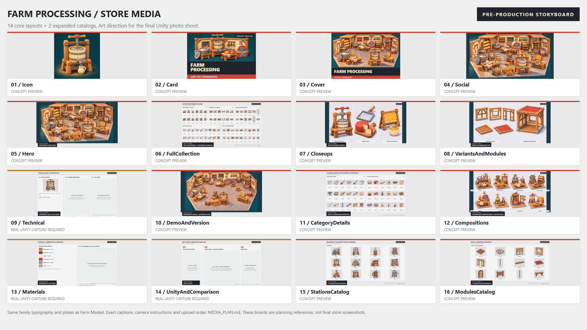

# Farm Processing — кадры для страницы Asset Store

2026-11-13. Подготовлено: **14 основных макетов + 2 увеличенных каталога**, семь новых генеративных исходников без текста, точные плашки и подписи. Это раскадровка будущей съёмки продукта: 3D-пак ещё не собран. Макеты не являются готовыми файлами загрузки.

[Все кадры одним листом](REVIEW_CONTACT_SHEET.png) · [Галерея](index.html) · [Реестр](media-manifest.json) · [Промпты новых кадров](generation-manifest.json)

## Что взято из других наших ассетов

Основа — фактические изображения Farm Market из соседней рабочей папки `master/output/FarmMarket_421724_Media_2026-11-02/Upload` и общий [REQUIREMENTS.md](../../../../REQUIREMENTS.md), разделы 7.4–7.8. Просмотрен `REVIEW_CONTACT_SHEET.jpg` Farm Market. Сохранены тёмные нижние плашки, кремово-белый жирный текст, красная акцентная строка, компактная подпись темы в галерее и светлый фон каталога. Чужие логотипы и числа Farm Market не перенесены.

Отличие Processing: герой — корзиночный соковый пресс, а не рыночный прилавок. Для обзорных сцен используется глубокий сине-зелёный фон и тёплый свет из выбранного превью; для каталогов — светло-серый фон референсов. У Farm Market общий фон был светлее, но типографика и расположение плашек остаются родственными.

## Основные изображения: 01–04

Размеры ниже — рабочий стандарт нашей серии; финальные поля сверить с Publisher Portal. Мастера и уменьшенные варианты лежат рядом в `Boards/`.

| Кадр | Размер / мастер | Как расположить | Точная подпись |
|---|---|---|---|
| [01_Icon](Boards/01_Icon.png) | Мастер 1024×1024, [экспорт 160×160](Boards/01_Icon_160x160.png) | Пресс крупно по центру, маленький керамический кувшин у носика, фон teal. Силуэт целиком, без двора и мелких инструментов | Без текста |
| [02_Card](Boards/02_Card.png) | Мастер 1260×840, [экспорт 420×280](Boards/02_Card_420x280.png) | Вверху компактная группа: чан слева, пресс в центре, печь справа. Нижние 38% — название и акцент. Самостоятельная композиция для выдачи | `FARM PROCESSING` / `LOW POLY WORKSHOPS` |
| [03_Cover](Boards/03_Cover.png) | 1950×1300 | Двор целиком, пресс впереди справа, чан слева, высокие объекты сзади. Нижние 24% — графика; станки целиком над плашкой | `FARM PROCESSING` / `LOW POLY WORKSHOPS` |
| [04_Social](Boards/04_Social.png) | 1200×630 | Чистый широкий кадр двора. Центральные объекты переживают боковую обрезку. Без больших подписей | Без текста |

`CONCEPT PREVIEW` на текущих Card/Cover — редакторская маркировка макета. Она не является будущим бейджем продукта. Логотип не придуман: готового файла логотипа в найденном комплекте нет. Если будет предоставлен собственный знак, поставить слева от названия, не уменьшив читаемость названия.

## Галерея: 05–14

Все кадры 1920×1080. В таблице указаны подписи для будущих кадров реального продукта. Числа разрешено использовать после сверки итогового реестра; до этого текущие макеты прямо говорят о reference designs / design study.

| Кадр | Что показать и как расположить | Подпись будущего кадра |
|---|---|---|
| [05_Hero](Boards/05_Hero.png) | Главный двор без крупного названия: передний план сыроварение и сок, средний — столы и продукты, задний — печь, сушилка и коптильня. Камера ¾, около 32–40° вниз, проход читается | `WORKSHOP COURTYARD` |
| [06_FullCollection](Boards/06_FullCollection.png) | Все 72 исходных референса без перерисовки, по ID. Верх: 12 станций, 12 предметов мебели, 12 архитектурных модулей. Низ: 18 инструментов и 18 продуктов. Равные промежутки, без пересечений | `FULL COLLECTION` или после приёмки `FULL COLLECTION · 72 PROPS` |
| [07_Closeups](Boards/07_Closeups.png) | Три крупных панели: винт и прижим пресса; сырный срез и лира; рамка сот и мёд. Резкие детали, без сильного DOF. Одна подпись на панель | `MODEL DETAILS`; панели `SCREW & PRESS PLATE`, `CHEESE & TOOLS`, `HONEY & HONEYCOMB` |
| [08_VariantsAndModules](Boards/08_VariantsAndModules.png) | Слева отдельные стеновые/напольные модули; справа собранный небольшой рабочий отсек. Одинаковый свет и ракурс, видны стыки. Показана сборка, не несуществующие цветовые варианты | `MODULAR WORKSHOP KIT`; подписи `SEPARATE MODULES` / `ASSEMBLED WORKSHOP BAY` |
| [09_Technical](Layouts/09_Technical.png) | Макет трёх колонок: финальный shaded, тот же объект в Shaded Wireframe, реальные collider gizmos. Представители STA-05, STA-01, STA-09. Вставить реальные измеренные tris и наличие LOD | `GEOMETRY, LOD & COLLIDERS` |
| [10_DemoAndVersion](Boards/10_DemoAndVersion.png) | Второй обзор двора с более высокой камеры и другого направления. Главная информация — рабочие островки, ширина проходов и планировка. В Unity снять действительно сверху-справа около 50–55° вниз | `WORKSHOP COURTYARD · ALTERNATE VIEW` |
| [11_CategoryDetails](Boards/11_CategoryDetails.png) | Две крупные сетки: 18 инструментов слева, 18 продуктов справа. Категории подписаны, ID остаются в макете для сборки. В финале ID заменить короткими английскими названиями либо убрать | `TOOLS & PROCESSED PRODUCTS` |
| [12_Compositions](Boards/12_Compositions.png) | Восемь самостоятельных виньеток 4×2, без высоких стен. У каждой подпись и свободное место вокруг. Это план CMP-01–08, а не восемь новых моделей | `WORKSHOP COMPOSITIONS`; после проверки поставки `8 READY WORKSHOP COMPOSITIONS` |
| [13_Materials](Layouts/13_Materials.png) | Макет: фактические атласы и Base Color слева, 2–3 финальные модели справа. Вставить реальные размеры, число карт и материалов. Цветовые квадраты сейчас только art direction | `MATERIALS & TEXTURES` |
| [14_UnityAndComparison](Layouts/14_UnityAndComparison.png) | Макет реального скриншота Editor: слева Project с папками пака, в центре демо и выбранный префаб, справа читаемый Inspector. Для этого продукта сравнение Lite/Full не нужно | `UNITY SETUP` |

09, 13 и 14 намеренно оформлены как **LAYOUT TEMPLATE** с местами для фактических скриншотов. Wireframe, интерфейс Unity и технические цифры не сгенерированы. Их подготовка требует будущей 3D-сборки.

## Дополнительные каталоги для читаемости

| Кадр | Расстановка | Подпись |
|---|---|---|
| [15_StationsCatalog](Boards/15_StationsCatalog.png) | 12 станций, сетка 4×3. Предметы крупнее, чем на полном каталоге, одинаковая камера. Масштаб внутри группы сопоставимый; чётко различимы сырный, соковый и масляный прессы | `PRODUCTION STATIONS`; число 12 добавить после проверки |
| [16_ModulesCatalog](Boards/16_ModulesCatalog.png) | Все 12 архитектурных референсов, сетка 4×3. В финале длинные балки и столбы вынести в отдельный узкий ряд, не делать им огромные пустые клетки | `ARCHITECTURE MODULES`; число 12 добавить после проверки |

Если слотами или вниманием покупателя нужно ограничить галерею, дополнительные каталоги используются вместо менее информативного второго обзора, а не уменьшаются до нечитаемой миниатюры.

## Точная последовательность на странице

Четыре основных файла назначаются своим полям Icon / Card / Cover / Social, а не загружаются повторно как скриншоты.

Порядок галереи: **05 Hero → 06 Full Collection → 15 Stations → 07 Closeups → 08 Modules → 16 Architecture → 11 Tools & Products → 12 Compositions → 10 Alternate View → 09 Technical → 13 Materials → 14 Unity Setup**.

Так покупатель сначала видит результат, затем состав и качество, после — способы сборки и технические подтверждения. Порядок загрузки отличается от числового имени файла; это намеренно.

Видео, если готово: перед скриншотами. План на 40 секунд: 0–7 общий двор; 7–14 сыроварение; 14–21 соковый пресс; 21–28 печь, сушка и копчение; 28–34 масло и мёд; 34–40 восемь композиций. Движение камеры и turntable допустимы; механическую анимацию не изображать как поставляемую, пока её нет в паке. Титр: `FARM PROCESSING` / `LOW POLY WORKSHOPS`.

## Как повторить оформление в финальных кадрах

- Шрифт: Segoe UI Bold в локальных макетах; будущую лицензированную гарнитуру выбрать один раз на всю серию. Максимум два согласованных начертания. Название кремовое `#F2E6C9`, тёмная плашка `#20242A`, акцент `#C8473B`.
- Галерея: нижняя левая плашка около 8–12% высоты. Первая строка `FARM PROCESSING`, вторая — тема кадра. На 1920×1080 ориентир 19 px для имени и 32 px для темы; поля слева 32 px, снизу 24 px.
- Card: две строки названия, проверка именно при 420×280. Cover: одна строка названия с большим кеглем. Акцент содержит один тезис, а не список обещаний.
- На Social и Icon не переносить плашку названия. Разрешить изображению работать силуэтом. Не добавлять цену, скидки, звёзды, награды, `NEW`, `MOBILE READY` и непроверенное `URP`.
- Снимать исходник без графики, финальную плашку накладывать отдельным слоем. Держать источник и оформленный кадр раздельно; названия и счётчики обновлять без повторного рендера моделей.
- Компоновку брать из концептов, точные модели и комплектность — из каталога. Дополнительные яблоки, стеклянные бутылки, салфетки или ящики, появившиеся в генеративном концепте, автоматически не включены в набор. При финальном рендере заменить их предметами реестра или убрать.

## Подписи восьми композиций

Верхний ряд: **DAIRY · JUICE PRESSING · GRAIN MILLING · JAM & DRYING**.

Нижний ряд: **BAKERY · SEED OIL · SMOKEHOUSE · HONEY**.

Это соответствует CMP-01–08 из [плана продукта](../../../../FARM_PROCESSING_PACK.md). После сборки каждый CMP должен существовать как отдельный prefab; просто похожая группа предметов на кадре не подтверждает готовый composition prefab.

## Что заменяется перед загрузкой

В `ArtDirection/` хранятся концепты, reference boards и схемы. Их `upload_ready` в реестре равен `false`. Конечные изображения реального продукта готовить в отдельной `Media/Final/` после сборки. Для каталогов заново снять те же 72 ID из фактических моделей; для общих кадров повторить камеры и свет; для 09/13/14 вставить реальные доказательства. Удалить редакторские метки и заменить проектные числа измеренными.

По [Unity Asset Store Content Transparency, 2.7.6](https://unity.com/legal/asset-store-content-transparency), полностью AI-сгенерированные изображения не используются целиком как marketing/showcase, кроме фоновых и дополнительных элементов. [Submission Guidelines, 1.6.b и 3.1](https://assetstore.unity.com/publishing/submission-guidelines) требуют точного отражения продукта и достоверных сведений. Проверено 2026-11-13. Это причина сохранять текущие кадры как раскадровку, а финальные делать из Unity.

## Исходники и повторный экспорт

- `Raw/` — семь новых изображений без текста и точные `.prompt.txt`; исходный Hero сохранён в `planning/FarmProcessing/previews/`.
- `Boards/` — 13 концептуальных/каталожных оформленных кадров плюс уменьшенные Icon/Card.
- `Layouts/` — три схемы технических скриншотов.
- `frames.html`, `catalog.js` — редактируемая вёрстка и данные референсов; `index.html` — обзор с кликабельными кадрами.
- `generation-manifest.json` — встроенный image_gen, промпты и использованные изображения. `media-manifest.json` — размеры, статус и подписи после приёмки. `export-audit.json` — проверка загрузки изображений браузером.
- `export_boards.py` — повторный экспорт через Orca browser. Запускать локальный HTTP-сервер из корня рабочего проекта, открыть `frames.html`, передать ID выделенной страницы через `--page`. Файл не управляет Unity и не публикует продукт.
