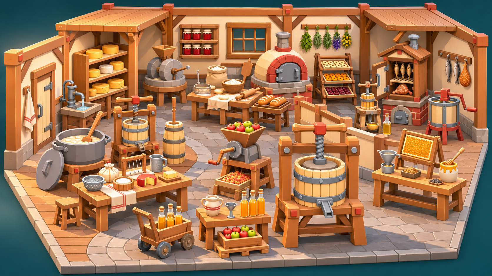

# Превью Farm Processing & Workshops

Концепт композиции для страницы ассета. Изображение создано встроенным image_gen; это художественный ориентир для последующей сборки 3D-сцены. Точную комплектность и размеры проверять по каталогу при сборке.

## Композиция

Открытый двор мастерской примерно 12 × 10 м, камера спереди в ракурсе ¾, наклон около 32°. Передний край открыт. Высокие стены, стеллажи и коптильня стоят сзади; столы образуют средний план; соковый пресс — главный акцент впереди, чуть правее центра. Между зонами проходит свободный извилистый проход шириной около 1–1,2 м.

| Зона | Станции | Мебель | Инструменты и продукты |
|---|---|---|---|
| Слева: сыроварение | STA-01, STA-02, STA-03 | FUR-01, FUR-03, FUR-06 | TOL-01–06, TOL-10–12; PRD-01–04 |
| Впереди по центру: сок и фасовка | STA-04, STA-05 | FUR-02, FUR-07, FUR-08, FUR-12 | TOL-07; PRD-05–06 |
| Сзади слева: выпечка | STA-06, STA-09 | FUR-09 | TOL-08–09, TOL-13–14, TOL-16; PRD-10–11, PRD-13 |
| Сзади в центре: варенье и сушка | STA-07, STA-08 | FUR-04, FUR-05 | PRD-07–09, PRD-12 |
| Справа: масло, копчение и мёд | STA-10, STA-11, STA-12 | FUR-10, FUR-11 | TOL-15, TOL-17–18; PRD-14–18 |
| Архитектурная рамка | MOD-01–12 | Повторяемые модули пола и стен; плоские навесы только в задних углах | MOD-12 — под окном, MOD-10 — низкая граница зоны |

Каждый ID распределён в одну основную зону. Подставка FUR-07 показывается без дополнительного пресса, если оба пресса уже установлены отдельно. Мелкие предметы группируются на столах по назначению, подвесы — на рейках; не рассыпать инструменты по полу. Навесы не должны закрывать оборудование. Количество видимых предметов в концепте не является инвентаризацией всех 72 моделей.

## Цвет и свет

Сохранять палитру моделей: тёплое дерево, кремовый, кораллово-красный, матовый металл и серый камень. Фон и внешняя студийная плоскость — глубокий сине-зелёный `#173C45`. Золотистый основной свет сверху слева, прохладное заполнение справа; тени читаемые, без проваленных в чёрный участков. Сыр, хлеб, мёд и варенье дают яркие небольшие акценты.

Формат основного кадра — широкий 16:9, без надписей. Сохранить поля вокруг силуэта и основания. При уменьшении до миниатюры первыми должны читаться соковый пресс, чан, печь и архитектурная рамка; мелкие инструменты работают на детализацию при увеличении.

## Генерация

[Точный промпт](HERO_SCENE_PROMPT.txt). Пять визуальных входов: STA-05, STA-01, STA-09, STA-11, MOD-04; состав и распределение всех категорий заданы текстом по каталогу из 72 позиций. Ограничение генератора — до пяти входных изображений за вызов.
